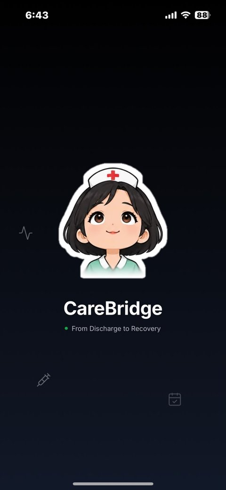
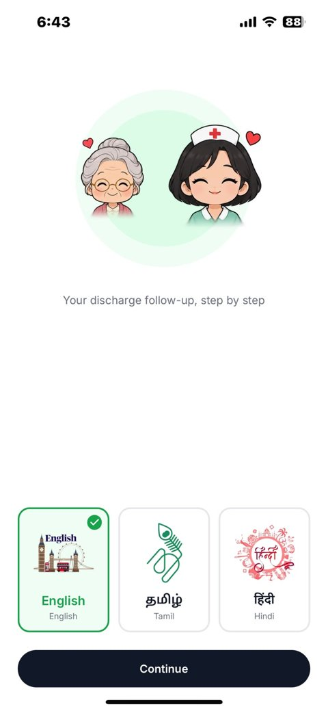
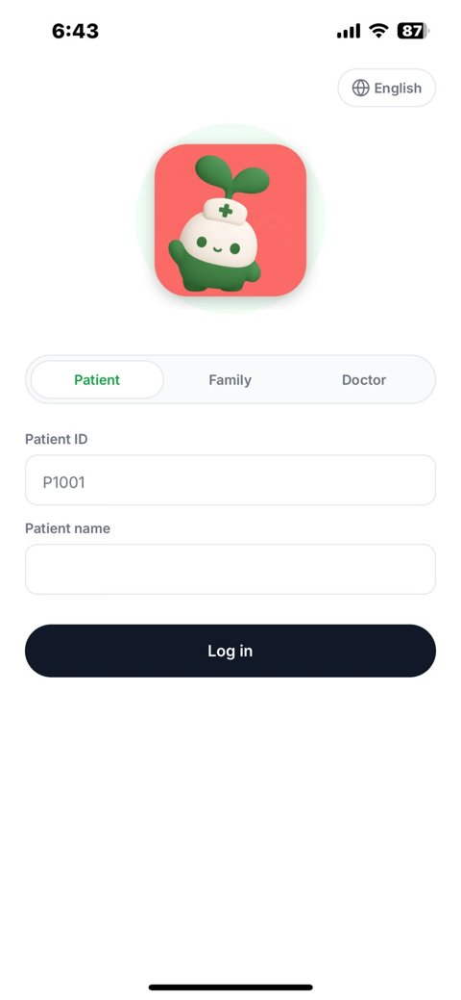
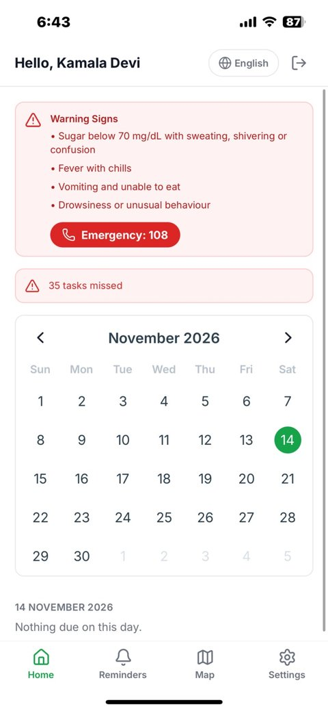
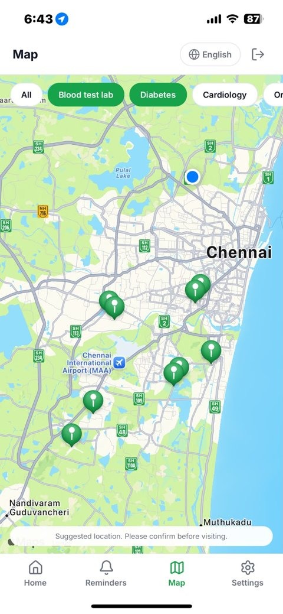
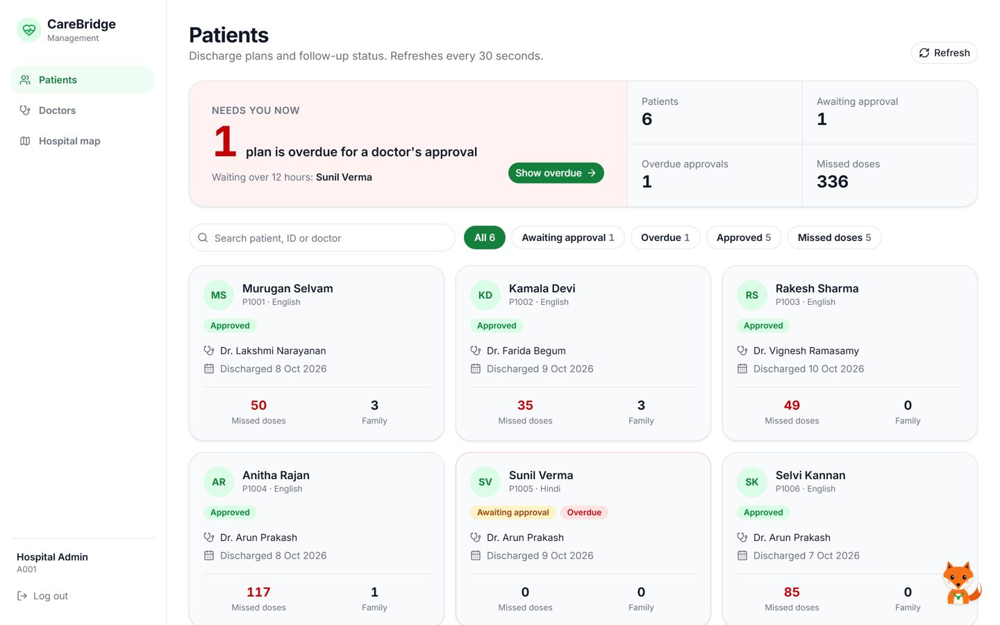
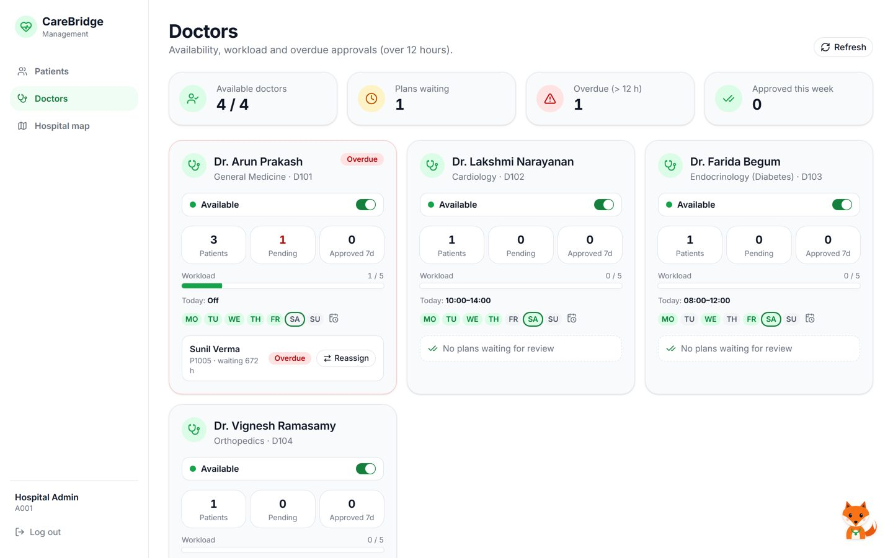
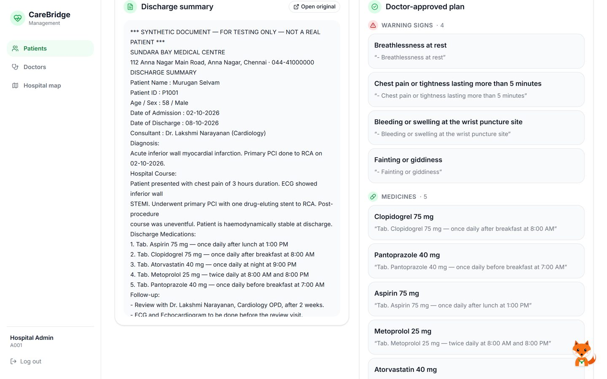
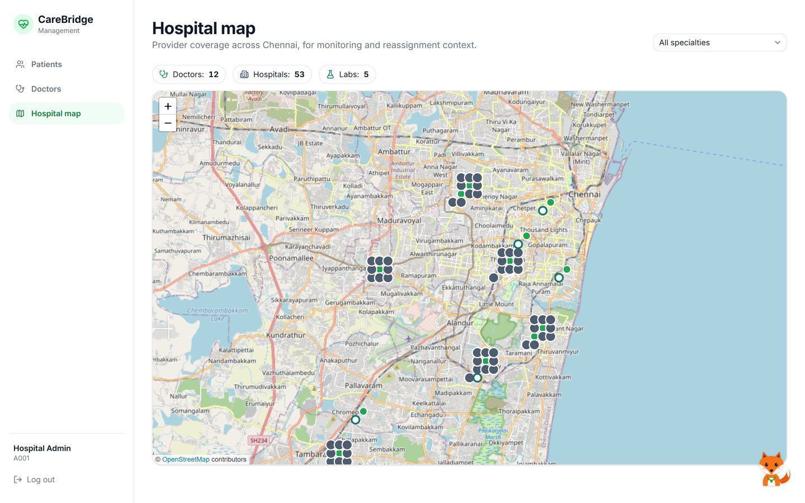

<p align="center">
  
</p>

**CareBridge** turns a synthetic hospital discharge summary into a **doctor-approved, trackable follow-up plan**:
medicines, tests, appointments and warning signs, with daily reminders and a calendar for the patient and their family.

Built after the **Acentra hackathon (Oct 2026)**: 1st of 30, then 2nd in the top-5 round for want of a demo.
This repo is that demo. 📄 [The story as a LinkedIn carousel (PDF)](docs/linkedin/CareBridge%20-%20The%20Demo%20I%20Didn't%20Have.pdf)

> All patient, doctor, hospital and provider data in this project is **synthetic**. No real people.

---

## How it works

```
Discharge summary (PDF · photo · text)
        │
        ▼
 1 Read ─▶ 2 Validate ─▶ 3 Extract ─▶ 4 Verify ─▶ 5 Safety flags ─▶ 6 Doctor approves ─▶ Reminders
   OCR       is it a        gpt-oss-120b   every value     missing dose,      edit + approve,      patient +
             discharge?     (Groq)         must exist in   vague words,       one locked           family
                                           the source      duplicates         transaction
```

- **AI reads, rules decide.** Every plan item keeps the exact source line it came from.
- **Nothing reaches a patient before a doctor approves.**
- **Drug names never get translated.** Reminders come in English, Tamil and Hindi, but medicines use a fixed template:
  `Clopidogrel 75 mg` stays word for word, only "after breakfast" changes language.

## Screens

**Mobile app (Expo)**: patient, family and doctor in one role-based app

| Splash | Language | Login | Home | Map |
|:---:|:---:|:---:|:---:|:---:|
|  |  |  |  |  |

**Management website (React)**: for the hospital admin

| What needs you now | Doctors and workload |
|:---:|:---:|
|  |  |
| **Summary next to the approved plan** | **Provider map** |
|  |  |

## Features

| | |
|---|---|
| **Plan extraction** | Discharge summary → medicines, tests, appointments, referrals, care, warning signs |
| **Doctor review** | Edit any item (with full edit history), then approve in one locked transaction |
| **Reminders** | Morning / afternoon / night slots, read-aloud, pill photos (Hub Manager), calendar |
| **Family hub** | First family member to join becomes Hub Manager; missed doses push an alert to the family |
| **Escalation** | Plans waiting over 12 hours are flagged overdue on the admin console |
| **Reassignment** | Mark a doctor unavailable and their pending plans move to the best available doctor |
| **Provider map** | Nearby doctors, hospitals and labs, filtered by the specialties in the patient's plan |
| **Reliability** | Queued uploads with backoff, unique tasks, conditional mark-done, atomic missed-dose alerts |

## Stack

| Part | Built with |
|---|---|
| Backend | Python **FastAPI**, psycopg 3, **APScheduler**, pdfplumber + Tesseract OCR |
| AI | **Groq**: `openai/gpt-oss-120b` (extraction), `openai/gpt-oss-20b` (translation, non-medicine text only) |
| Database / files | **Supabase** Postgres + private Storage bucket |
| Mobile | **Expo SDK 58**, Expo Router, NativeWind, Reanimated, expo-notifications, expo-speech |
| Website | **React + Vite**, TypeScript, Tailwind v4, **shadcn/ui**, motion, Leaflet / OpenStreetMap |

## Project structure

```
backend/      FastAPI app: routes, pipeline, jobs, db schema + migrations + seeds
mobile/       Expo app (src/app = screens, src/components, src/lib)
management/   React admin website
Dataset/      Synthetic discharge documents used in testing
docs/         README art, screenshots, the LinkedIn carousel
*.md          Specs: project, backend, frontend, dataset, design, decisions, testing
```

## Run it locally

Copy each `.env.example` to `.env` and fill in your own Supabase, Groq and JWT values (never commit `.env`).

```bash
# database: run backend/db/schema.sql, migrate_00*.sql, seed.sql, seed_providers.sql in the Supabase SQL editor

cd backend && python -m venv .venv && .venv\Scripts\pip install -r requirements.txt
.venv\Scripts\python -m uvicorn app.main:app --host 0.0.0.0 --port 8000

cd management && npm install && npm run dev        # http://localhost:5173

cd mobile && npm install && npx expo start --lan   # scan the QR in Expo Go (SDK 58)
```

Set `EXPO_PUBLIC_API_URL` in `mobile/.env` to your computer's Wi-Fi IP so the phone can reach the backend.

<p align="center">
  
</p>
